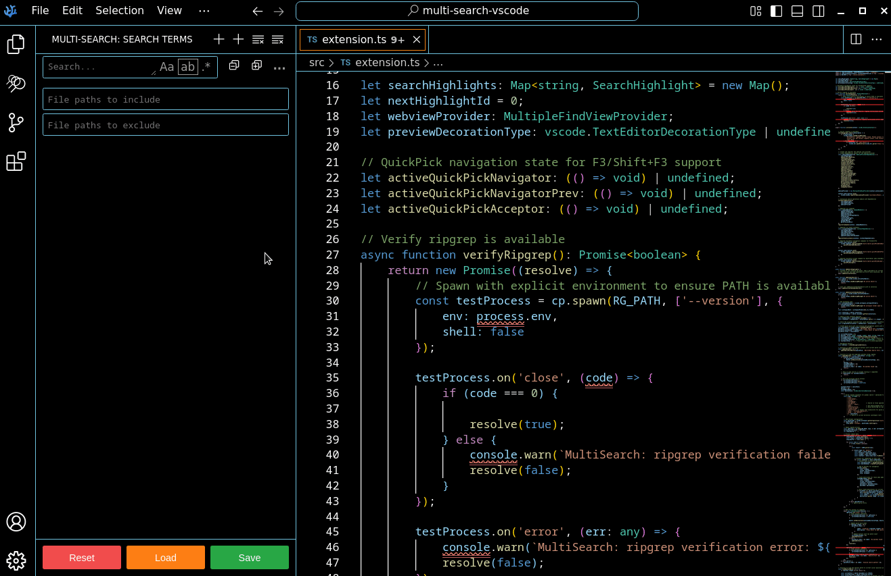

# Multi-Search

A powerful VSCode extension that allows you to **search and highlight multiple terms simultaneously** with different color coding. Perfect for tracking multiple variables, functions, or concepts across your codebase.



## Features

### What Multi-Search Adds to VSCode

- **Multiple Searches** - Each search term gets a unique color for easy visual distinction.
- **Visited Match Tracking** - Matches you've clicked on are automatically marked as grayed out to help you track which results you've already reviewed.
- **Pause Searches** - Temporarily disable highlighting for any search without removing it. Useful when you have many active searches and want to focus on specific ones.
- **Persistent Search History** - Save your searches and reload them across sessions. Perfect for recurring search patterns or working on long-term projects.
- **Live Match Previews in Panel** - See all matches with syntax-highlighted code snippets in a dedicated panel.
- **Highly Customizable** - Multiple settings let you tailor the experience to your preferences:
    - Override Ctrl+F behavior
    - Auto-expand search results
    - Mark visited matches
- **Merging searches** - Combine related search terms by dragging one onto another. No need to manually edit regex patterns.
- **Per-Search File Filters** - Each search can have its own include/exclude patterns.
- **Per-Search Result Display** - Each search can have its own view: flat or tree view.

### Already in VSCode Search

- **Current File & Global Search** - Search in the active file or across your entire workspace.
- **Flexible Search Modes** - Regex, case-sensitive, and whole-word matching.
- **Quick Navigation** - Jump between matches with keyboard shortcuts.
- **Fast Performance** - Powered by ripgrep for lightning-fast file searches.
- **Flexible Result Display** - View global search results in two modes:
    - **Tree View** - Shows results organized by folder structure (default)
    - **Flat View** - Shows results as a simple path list

## Installation

Please install [ripgrep](https://github.com/BurntSushi/ripgrep#installation) for file search functionality.

### From VSCode Marketplace

1. Open VSCode/VSCodium
2. Go to Extensions (Ctrl+Shift+X)
3. Search for "Multi-Search"
4. Click Install

### Manual Installation

1. Download the `.vsix` file from the [releases page](https://github.com/Ghizmoo/multi-search-vscode/releases)
2. Open VSCode/VSCodium
3. Go to Extensions (Ctrl+Shift+X)
4. Click the "..." menu → Install from VSIX
5. Select the downloaded `.vsix` file

### From Source

```bash
git clone https://github.com/Ghizmoo/multi-search-vscode.git
cd multi-search-vscode
npm install
npm run compile
```

Then press F5 to launch the Extension Development Host.

## Usage

### Quick Start

**Current File Search (Ctrl+F / Cmd+F)**
- With text selected: Automatically searches for the selection in the current file
- Without selection: Opens input field to enter search term

**Global Search (Ctrl+Shift+F / Cmd+Shift+F)**
- With text selected: Searches for the selection across the entire workspace
- Without selection: Opens input field to enter search term

### Search Panel

The Multi-Search panel appears in the Activity Bar (left sidebar) with a colorful search icon. It shows:

- All active searches with their color coding
- Number of matches for each search
- File paths for global searches
- Match previews with syntax highlighting

### Search Options

Each search supports:

- **Aa** - Case sensitive matching
- **ab** - Whole word matching
- **.\*** - Regular expression mode

Click these buttons in the search input to toggle options.

### File Filters

For global searches, you can filter which files to search:

**Files to Include:**
- Single pattern: `src/**/*.ts`
- Multiple patterns: `src/**/*.ts, tests/**/*.js, lib/**/*.tsx`

**Files to Exclude:**
- Single pattern: `**/node_modules/**`
- Multiple patterns: `**/*.test.ts, **/dist/**, **/node_modules/**`

**Glob Pattern Examples:**
- `**/*.js` - All JavaScript files
- `src/**` - Everything in src/ directory
- `*.{ts,tsx}` - TypeScript and TSX files in root
- `!**/test/**` - Exclude test directories

### Navigation

**Keyboard Shortcuts:**
- `F3` - Next match (in QuickPick)
- `Shift+F3` - Previous match (in QuickPick)
- `F4` - Next match (global)
- `Shift+F4` - Previous match (global)

**Click Actions:**
- Click on a match → Jump to that location in the file
- Click "Show matches" → Expand file to show all matches
- Click file path → Edit include/exclude paths

### Managing Searches

**Add Search:**
- Use Ctrl+F or Ctrl+Shift+F shortcuts
- Click the + icon in the MultiSearch panel
- Right-click a folder → "MultiSearch: Find in Folder..."

**Clear All:**
- Click the "Clear All" icon in the panel header

**Merge Searches:**
- Hold Ctrl (Cmd on Mac) while dragging one search onto another
- The modifier key can be customized in settings

## Configuration

Open VSCode Settings (Ctrl+,) and search for "MultiSearch":

### `multiSearch.mergeModifierKey`

Modifier key to use when dragging to merge search terms.

- **Options:** `ctrl`, `alt`, `shift`
- **Default:** `ctrl`
- **Note:** On Mac, `ctrl` automatically becomes `cmd`

### `multiSearch.showFileFiltersByDefault`

Show file include/exclude filters by default in the search panel.

- **Type:** boolean
- **Default:** `false`

### `multiSearch.maxThreads`

Number of threads to use for ripgrep searches.

- **Type:** number (0-64)
- **Default:** `0` (automatic)
- **Note:** When set to 0, ripgrep automatically determines the optimal number of threads based on your CPU. Increase this value for faster searches on multi-core systems, or decrease it to reduce CPU usage.

### `multiSearch.defaultDisplayMode`

Default display mode for global search results.

- **Options:** `tree`, `flat`
- **Default:** `tree`
- **Description:**
    - `tree` - Shows results organized in folder structure (hierarchical view)
    - `flat` - Shows results as a simple path list, similar to VSCode's native search

### `multiSearch.autoExpandResults`

Automatically expand folders and files in global search results when a search completes.

- **Type:** boolean
- **Default:** `true`
- **Description:** When disabled, only the file/folder list is shown without expanding individual match lines.

### `multiSearch.markVisitedMatches`

Mark clicked match lines as visited with reduced opacity.

- **Type:** boolean
- **Default:** `true`
- **Description:** When enabled, matches you click on are visually grayed out to help track which results you've already reviewed. State is preserved when switching panels.

### `multiSearch.overrideCtrlF`

Override Ctrl+F to use MultiSearch instead of VSCode's native search.

- **Type:** boolean
- **Default:** `false`
- **Description:** When disabled, Ctrl+F uses VSCode's default search behavior. Useful if you prefer MultiSearch's features.

### `multiSearch.enterNavigatesMatches`

Change Enter key behavior in the search quick pick.

- **Type:** boolean
- **Default:** `false`
- **Description:** When enabled, pressing Enter navigates to the next match (like F3), and Ctrl+S (Cmd+S on Mac) saves the search. When disabled, Enter saves the search (default behavior).

## Commands

All commands are available via the Command Palette (Ctrl+Shift+P):

- `MultiSearch: Add Search` - Add a new search term
- `MultiSearch: Add Selection to Find` - Search selected text in current file
- `MultiSearch: Add Global Search` - Add a workspace-wide search
- `MultiSearch: Add Selection to Global Search` - Search selected text in workspace
- `MultiSearch: Find in Folder...` - Search in a specific folder
- `MultiSearch: Clear All` - Remove all active searches
- `MultiSearch: Go to Next Match` - Jump to next match
- `MultiSearch: Go to Previous Match` - Jump to previous match

## Troubleshooting

**Searches not working:**
- Ensure ripgrep is installed (bundled with extension via npm)
- Check the Developer Console (Help → Toggle Developer Tools) for errors

**Highlights not showing:**
- Make sure the file is not too large (VSCode has limits on decorations)
- Check that the search term exists in the visible range
- Try reloading the window (Ctrl+Shift+P → "Reload Window")

## Credits

- !AlphaTartine: Beta testing and great ideas !